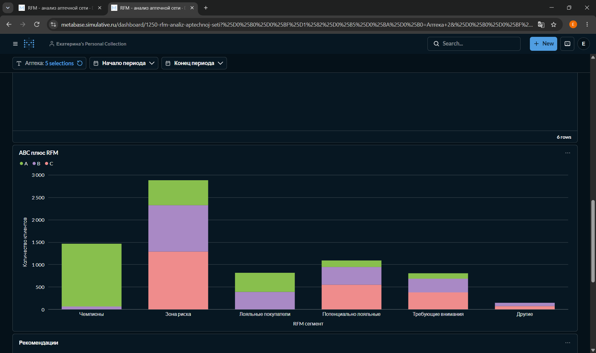
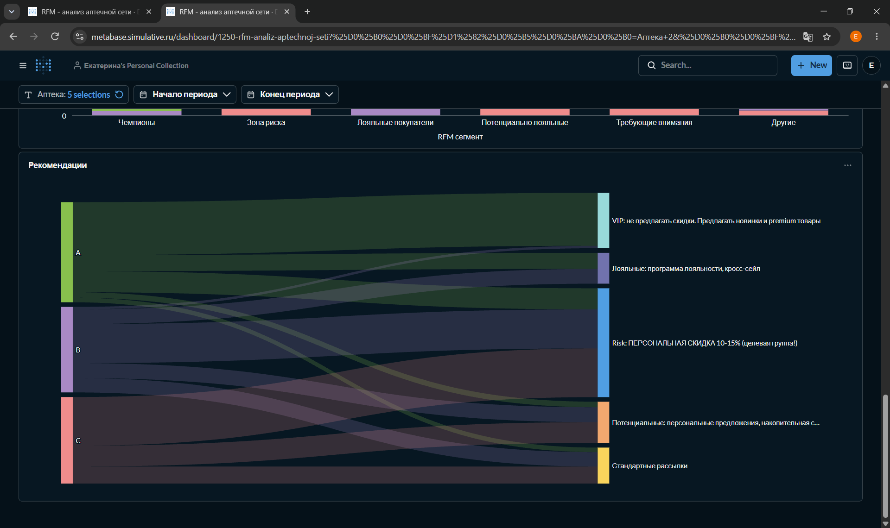

# 📊 RFM- и ABC-анализ клиентской базы аптечной сети

## 🎯 Цель проекта
Провести сегментацию базы держателей карт лояльности (38 486 клиентов) для повышения эффективности маркетинговых рассылок и оптимизации бюджета на программы лояльности в условиях ожидаемого сезонного спада.

## 🛠 Стек технологий
- **Базы данных и запросы:** PostgreSQL, SQL (CTE, оконные функции, `percentile_cont`)
- **Визуализация и BI:** Metabase
- **Дополнительно:** Python (pandas для предобработки), Excel
## 📸 Визуализация результатов

### Дашборд в Metabase

### Матрица ABC+RFM

### Рекомендации по сегментам (диаграмма Санки)

## 🔍 Ключевые этапы работы
1. **Расчет RFM-метрик:** Написаны SQL-запросы для вычисления давности последней покупки (Recency), частоты (Frequency) и общей суммы покупок (Monetary) для каждого клиента.
2. **Скоринг на основе перцентилей:** Вместо фиксированных порогов использованы перцентили (20%, 40%, 60%, 80%), что позволило автоматически адаптировать границы сегментов под фактическое распределение данных и избежать искажений из-за выбросов.
3. **ABC-анализ:** Клиенты ранжированы по вкладу в общую выручку (класс A – топ 80%, B – следующие 15%, C – оставшиеся 5%).
4. **Построение матрицы ABC-RFM:** Совмещение подходов позволило отсечь «шум» (например, клиентов с высокими RFM-оценками, но покупающих только дешевые товары) и сфокусировать дорогие маркетинговые механики на прибыльных клиентах классов A и B.
5. **Визуализация:** Создан интерактивный дашборд в Metabase с фильтрами по аптекам и датам.

## 💡 Ключевые инсайты и бизнес-рекомендации
- **Подтверждение гипотезы:** Сегмент «Чемпионы» составляет 50.53% базы и генерирует ~56% общей выручки (~18 млн ₽ из ~32 млн ₽).
- **Зона риска:** Выявлено 3 386 клиентов (8.8%), которые ранее покупали часто, но перестали заходить. 
- **Рекомендация 1:** Запустить срочную персональную рассылку со скидкой 10–15% для сегмента «Зона риска» (классы A и B). Ожидаемая конверсия в покупку >15%.
- **Рекомендация 2:** Не предлагать базовые скидки «Чемпионам» (это потеря маржи), вместо этого предлагать эксклюзив и новинки.
- **Рекомендация 3:** Исключить сегменты «Потерянные/Спящие» (класс C) из платных рассылок для экономии бюджета на 10–15%.

## 📁 Структура репозитория
- `sql/rfm_analysis.sql` – основные SQL-запросы для расчета метрик, перцентилей и сегментации.
- `metabase/` – скриншоты и экспорт настроек дашборда.
- `README.md` – описание проекта.

## 🔗 Ссылки
- [Интерактивный дашборд в Metabase](https://metabase.simulative.ru/public/dashboard/de89842c-c8e7-413b-abcb-8e6cc4b159de)
- [Мое резюме](https://izhevsk.hh.ru/resume/178972eeff10afe6890039ed1f4e6155745444)
